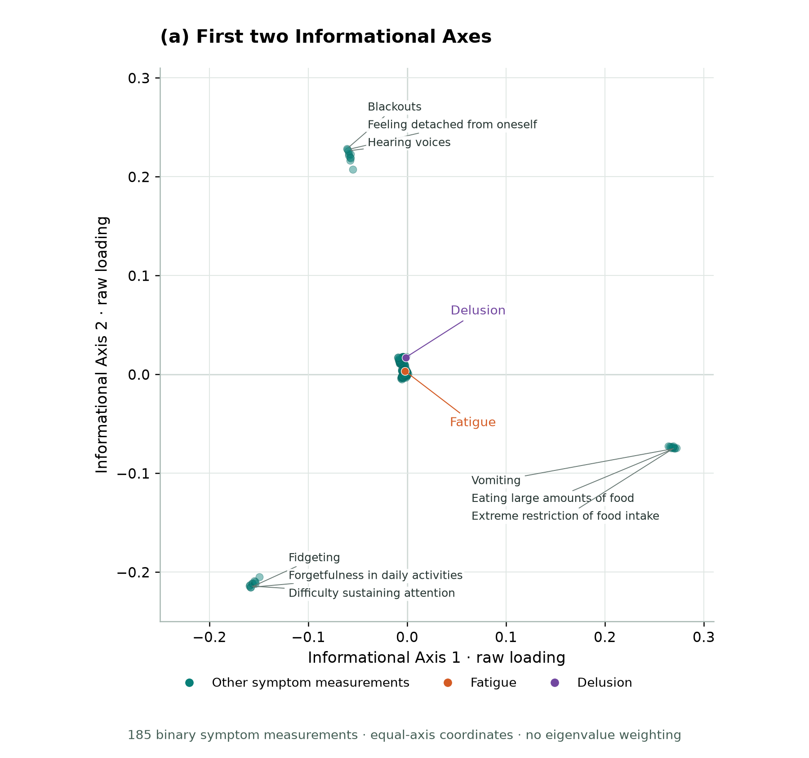
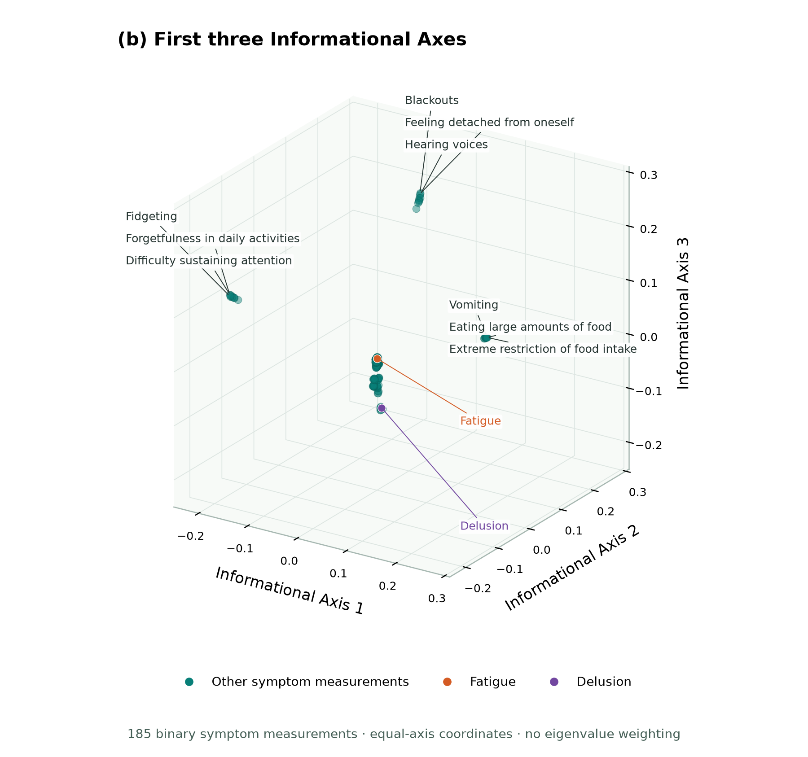

# The Entropic Scree
## Map the informational structure of your measurements

###### Initial Methods & Function Release: August 16, 2026 (Happy Birthday, Dad)

*[Terrence J. Lee-St. John, PhD](mailto:terry@enli.com.au)*  
*[Enli: Predictive systems that remain stable under change](https://www.enli.com.au)*

[](https://doi.org/10.5281/zenodo.22028086)
[](https://CRAN.R-project.org/package=Entropic.Scree)
[](LICENSE)

**[See the maps](#see-the-map) · [Simulation scripts](#simulation-scripts)**

## What does Entropic Scree do?

A dataset can contain hundreds or thousands of measurements without representing hundreds or thousands of distinct underlying processes. The same process may appear through different symptoms, sensors, thresholds, transformations, or combinations of measurements.

**Entropic Scree maps how measurements share information, examines the dimensional organization of that information, and summarizes its shared spectral footprint.**

The framework constructs a joint-entropy-normalized mutual information matrix among measurements, double-centers it, and examines its eigenvalues and eigenvectors. This connects three tasks:

- **Measurement mapping:** examine how measurements group together or express different informational contrasts.
- **Primary rank selection:** identify a candidate boundary separating the primary information spectrum from weaker directions.
- **Spectral-volume accounting:** summarize shared and idiosyncratic allocations and the shared footprint assigned to the primary axes.

**Each point in a measurement map represents a measurement, not an individual record.**

The selected **Primary Informational Rank** is the number of retained primary informational axes. Its correspondence with the number of generating coordinates is evaluated empirically; it is not assumed by definition.

## Why use an information-based spectrum?

Linear covariance can miss nonlinear dependence. Distance-based methods examine geometry among observations, but distance contrast can weaken in high-dimensional settings. Entropic Scree instead examines pairwise information relationships among measurements across their observed records.

| Analytical question | What Entropic Scree contributes |
|---|---|
| Do measurements share information despite weak linear correlation? | Mutual information captures pairwise dependence beyond linear association. |
| How can continuous and categorical measurements be compared? | Discrete and discretized measurements are represented through probability tables and a common information normalization. |
| How many primary informational directions are resolved? | The information spectrum provides a dimensional diagnostic complementary to covariance-based spectra. |
| Which measurements occupy similar or contrasting positions? | Eigenvector coordinates provide a geometry for examining measurement relationships. |
| Does a small shared percentage imply a negligible shared footprint? | Informational gravity expresses shared-volume allocations in variable equivalents per primary axis. |

These are complementary analytical perspectives. Entropic Scree is not a universal replacement for PCA, distance-based analysis, clustering, or predictive modeling.

## Understanding the outputs

| Output | Interpretation |
|---|---|
| **Entropic Scree plot** | The distribution of spectral weight across informational axes and the transitions within that spectrum. |
| **Primary Informational Rank** | The number of axes retained through the selected primary boundary. |
| **Extended Signal Tail boundary** | The inclusive endpoint of the broader spectral region used in shared-volume accounting. The additional tail follows the primary region. |
| **Measurement loadings and bipolar modules** | Measurements’ coordinates on informational axes and their contributions to the positive and negative poles. |
| **Total Unique Probabilistic Volume** | The entropy effective rank of the entire working spectrum. |
| **Total Shared Signal Volume** | The framework’s combined redundant and selected unique signal allocation, expressed in variable equivalents. |
| **Idiosyncratic Informational Volume** | The remaining effective-volume allocation, which can include noise and structure outside the selected region. |
| **Average Informational Gravity (AIG)** | Total Shared Signal Volume divided by the Primary Informational Rank. |
| **Factor-Specific Informational Gravity (FSIG)** | The shared volume allocated to each primary informational axis. Here, “factor-specific” means axis-specific. |
| **Structural Topology Profile** | Each primary axis’s FSIG relative to the leading axis. |
| **Negative Spectral Mass Ratio (NSMR)** | The magnitude of negative raw spectral mass relative to positive raw spectral mass. |

Both boundary indices identify the **last retained axis**. For example, a primary boundary of 20 retains axes 1 through 20. If the extended boundary is 34, the additional Extended Signal Tail consists of axes 21 through 34.

Volume and gravity are spectral accounting summaries. They are not direct measurements of the fraction of observed values generated by random error, and they do not establish that an axis represents a distinct causal mechanism.

## Measurement geometry and interpretation

The paper describes two coordinate systems:

- **Equal-axis coordinates** use the raw eigenvector coefficients on a stated retained axis set. Each retained direction receives equal total geometric weight.
- **Eigenvalue-scaled coordinates** weight positive directions by the square roots of their eigenvalues, preserving their relative spectral strength. The paper derives their relationship to normalized variation of information and explains the effects of positive-spectrum projection and omitted coordinates.

The coordinate choice changes distances and visual emphasis. Geometric clustering methods can be applied to a chosen measurement configuration, but cluster membership requires an additional grouping rule.

An axis’s sign is arbitrary. Its opposite poles describe contrasts in measurements’ information relationships; they do not signify positive versus negative correlation or uniformly “high” versus “low” observed values.

These measurement coordinates also do **not** natively justify observation-level factor scores. Projecting records onto them requires additional coding, scaling, and scoring assumptions that the pairwise information construction does not supply.

## See the map

These figures use a [public synthetic mental-health symptom dataset](https://www.kaggle.com/datasets/sarveshchhetri/mental-health-symptom-dataset-one-hot-encoded): **8,304 records and 185 binary symptom measurements**. The `Disease` label was excluded, and the binary states were treated as categorical.

The analysis selected **20 primary informational axes**. The figures show the first two and first three using equal-axis coordinates; neither displays the complete 20-dimensional primary configuration.

### Two axes reveal distinct concentrations of measurements

<p align="center">
  
</p>

Measurements around **vomiting**, **fidgeting**, and **blackouts** occupy distinct regions, while many other measurements remain close together in this view.

### A third axis reveals additional separation

<p align="center">
  
</p>

Adding the third axis reveals separation hidden in the two-axis view, including between **fatigue** (orange) and **delusion** (purple). Teal identifies the remaining measurements; these colors do not assign cluster membership.

Joint coordinates can reveal distinctions that individual pole summaries or lower-dimensional views conceal. Omitted axes may reveal further separation.

These figures illustrate measurement mapping in synthetic educational data. They do not validate clinical symptom groups or identify underlying causes.

## Get started in R

Install the R implementation from [CRAN](https://CRAN.R-project.org/package=Entropic.Scree):

```r
install.packages("Entropic.Scree")

library(Entropic.Scree)
library(data.table)

# Observations in rows; measurements in columns.
dt <- as.data.table(your_dataset)

# Represent nominal category codes as factors where appropriate.
# Example: dt[, category_code := factor(category_code)]

results <- Entropic.Scree(
  dt,
  interactive_mode = TRUE,
  extract_eigenvectors = TRUE,
  extract_bipolar_modules = TRUE
)

results$K_roots         # Selected Primary Informational Rank
results$K_extended      # Inclusive Extended Signal Tail boundary
results$AIG             # Average Informational Gravity
results$FSIG_final      # Gravity allocated to each primary axis
results$bipolar_modules # Measurements contributing to each pole
results$eigenvectors   # Full eigenvector matrix
```

The interactive interface lets you inspect and revise the recommended boundaries. Set `interactive_mode = FALSE` for unattended execution.

The full eigenvector matrix includes directions outside the selected primary region. For measurement mapping, explicitly choose the retained axis set and coordinate scaling.

The companion `Update.Entropic.Scree()` recalculates rank-dependent summaries from an existing result without repeating the pairwise information calculation or eigendecomposition.

Consult the documentation matching your installed package for missing-data options, retention criteria, loading-output defaults, and returned fields:

```r
packageVersion("Entropic.Scree")
help("Entropic.Scree", package = "Entropic.Scree")
help("Update.Entropic.Scree", package = "Entropic.Scree")
```

Nominal numerical codes should be explicitly represented as categorical measurements. The bin target must accommodate the represented categorical vocabularies; increasing it also changes the discretization target for numeric measurements.

Large measurement counts can require substantial memory and computation because the method constructs and decomposes a dense measurement-by-measurement matrix.

## Python package — coming soon

A Python implementation is planned. Installation instructions and a package link will be added when it is available.

## Simulation scripts

This repository provides two scripts for the experiments reported in the paper. **Both use direct calls to the published `Entropic.Scree` version 1.0.1**, pinned for reproducibility.

For general use, install the current CRAN release. Reproducing the reported experiments requires the version specified in the study scripts.

### 1. Replicated root-count simulations

[**Entropic-Scree-Replicated-Root-Count-Simulations.R**](Entropic-Scree-Replicated-Root-Count-Simulations.R)

This script evaluates automatic primary-boundary selection across:

- **21 generating counts:** 6 through 26.
- **Three root-dependence settings:** orthogonal, low entanglement, and high entanglement.
- **20 seeds per configuration.**
- **1,260 datasets in total.**
- **5,000 observations and 10,000 measurements per dataset**, equally divided between continuous and binary measurements.

It records per-run results, configuration summaries, and figures. The study evaluates the package’s automatic recommendations without manual boundary overrides.

### 2. Single-run method comparisons and binning ablation

[**Entropic-Scree-Single-Run-Method-Comparisons-and-Binning-Ablation.R**](Entropic-Scree-Single-Run-Method-Comparisons-and-Binning-Ablation.R)

This script examines three **20-root** datasets under orthogonal, low-, and high-entanglement settings. Within each setting, the same observations are analyzed using:

- Standard PCA.
- Rank-PCA.
- RBF Kernel PCA.
- Entropic Scree.

The orthogonal dataset also supports a binning ablation with targets of **18, 71, and 146 bins**. The 146-bin setting is an FD-derived global target passed to the same equal-frequency discretizer; it is not variable-specific equal-width Freedman–Diaconis binning.

These three datasets are the first-seed realizations of their corresponding configurations in the replicated study, not additional independent replications.

### Running the scripts

Use a dedicated R session and inspect the configuration before starting.

- R 4.2 or later is required.
- Change the replicated script’s `setwd(...)` line to an existing working directory on your computer.
- Review output locations and resource settings.
- Keep the scientific settings unchanged when reproducing the reported experiments.
- Required dependencies are installed as needed. Installing the pinned archived package may require platform compiler tools.
- Both scripts support resuming completed stages. Use the same settings and output location when resuming.

The full experiments are computationally demanding. The scripts save numerical summaries and figures; large generated-data checkpoints are removed after successful completion.

## What did the simulations show?

The replicated study held the dataset dimensions fixed at **5,000 observations and 10,000 measurements**. Each dependence setting contained 420 runs.

| Root-dependence setting | Exact match to generating count | Within one axis |
|---|---:|---:|
| Orthogonal | 70.2% | 100.0% |
| Low entanglement | 52.9% | 100.0% |
| High entanglement | 9.3% | 65.0% |

The orthogonal and low-entanglement results tracked the generating count closely, with systematic one-axis over-selection in parts of the tested range. High-entanglement performance was more variable.

The binning ablation also demonstrated an important distinction between **visible spectral structure** and **automatic boundary selection**:

| Bin target | Automatic Primary Informational Rank | Extended Signal Tail boundary |
|---|---:|---:|
| 18 | 20 | 173 |
| 71 | 20 | 50 |
| 146 | 5,019 | 5,051 |

At 146 bins, an early transition remained visible near axis 21, but the automatic rule selected a larger later break. Volume and gravity summaries also changed substantially with binning.

These findings support inspecting the spectrum alongside automatic recommendations. They do not establish universal generating-rank recovery, invariance to discretization, or comparative superiority over tuned alternative methods.

## Interpretation boundaries

- **Pairwise information is not all joint information.** A relationship can be jointly deterministic yet invisible in every pairwise comparison, as in a balanced XOR construction.
- **A returned rank is a candidate boundary.** It does not establish a clearly resolved elbow or an identified number of generating causes.
- **Binning and sample size matter.** They affect represented distinctions, contingency-table occupancy, estimated information, and potentially the selected boundaries.
- **Displayed maps omit information.** A two- or three-axis view represents only those coordinates.
- **Simulation evidence has a defined scope.** The replicated study varies generating count and root dependence at fixed dataset dimensions. The PCA-based comparisons are selected illustrations, not a replicated benchmark of tuned method families.

## Read and cite the paper

[**The Entropic Scree: An Information-Theoretic Mapping Framework for Estimating Intrinsic Rank and Informational Gravity in Tabular Systems**](https://doi.org/10.5281/zenodo.22028086)

The paper provides the mathematical construction, coordinate geometry, spectral-volume definitions, automated boundary rules, simulation design, and interpretation limits.

```bibtex
@misc{leestjohn2026entropic-scree,
  author    = {Lee-St. John, Terrence J.},
  title     = {The Entropic Scree: An Information-Theoretic Mapping Framework for Estimating Intrinsic Rank and Informational Gravity in Tabular Systems},
  year      = {2026},
  publisher = {Zenodo},
  doi       = {10.5281/zenodo.22028086},
  url       = {https://doi.org/10.5281/zenodo.22028086}
}
```

For the software citation, run:

```r
citation("Entropic.Scree")
```

Package DOI: [10.32614/CRAN.package.Entropic.Scree](https://doi.org/10.32614/CRAN.package.Entropic.Scree).

## Related resources

- [Entropic Scree on CRAN](https://CRAN.R-project.org/package=Entropic.Scree)
- [Entropic Scree preprint](https://doi.org/10.5281/zenodo.22028086)
- [From Garbage to Gold (G2G) preprint](https://arxiv.org/abs/2603.12288)
- [G2G simulation repository](https://github.com/tjleestjohn/from-garbage-to-gold)
- [Enli](https://www.enli.com.au)
- [Contact Terrence](mailto:terry@enli.com.au)

Distributed under the [Apache License 2.0](LICENSE).
